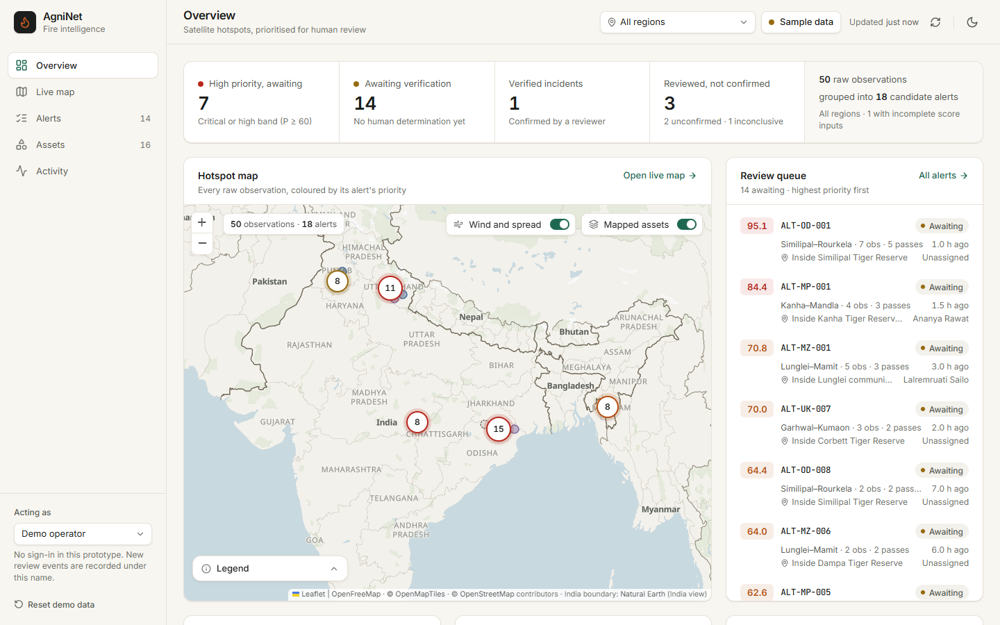
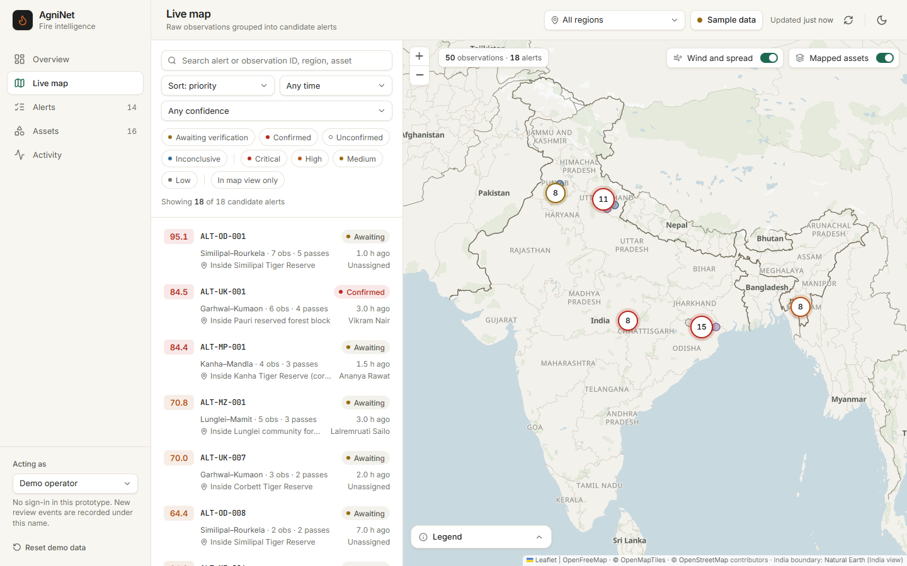
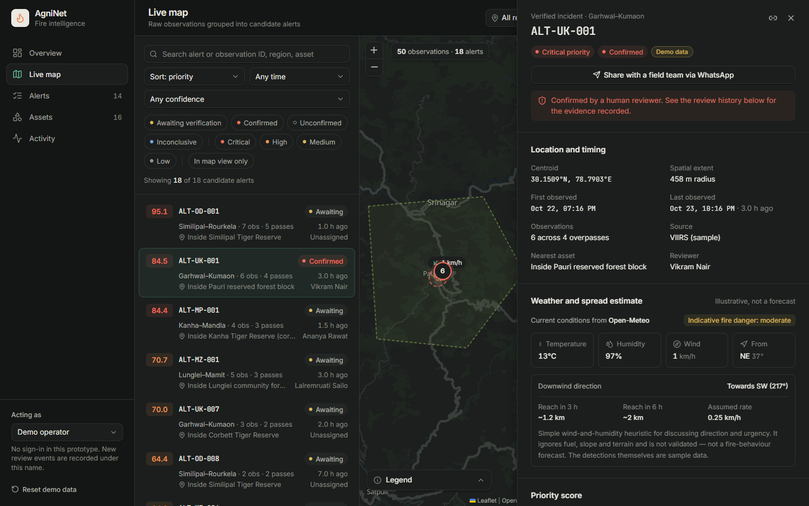

# AgniNet

Satellite fire intelligence and field-response coordination — a hackathon prototype.

AgniNet turns satellite thermal-hotspot observations into **prioritised candidate alerts** that human reviewers
investigate, verify and share with field teams. A hotspot is not a confirmed fire: raw observations, candidate
alerts and human-verified incidents are kept distinct throughout.

> **Sample data by default.** Observations are synthetic and generated in the browser. An optional live mode loads
> NASA FIRMS detections through a server-side proxy. Mapped asset boundaries are illustrative.



## Features

- Overview, live map, alert queue, mapped assets and activity log, in light and dark themes
- Map showing **India's official boundary**, including PoK, Aksai Chin and the Shaksgam valley, on a keyless vector
  basemap with clustered hotspots and asset overlays
- Documented priority score `P = 0.35C + 0.25R + 0.20F + 0.20A` with a per-factor breakdown; missing inputs are
  flagged, never assumed
- Verification workflow: assign reviewers, record status, actions and notes as an append-only history
- Current weather (Open-Meteo) and an illustrative 3 h / 6 h downwind spread envelope for the selected alert
- WhatsApp hand-off to field teams, with a pre-filled message and a history note
- Optional live **NASA FIRMS** feed (VIIRS + MODIS, last 24 h) with the key held server-side
- Shareable alert links and CSV export; LocalStorage persistence

| Map with India's official boundary | Alert details, weather and spread (dark) |
| --- | --- |
|  |  |

## Quick start

```bash
npm install
npm run dev      # http://127.0.0.1:5173
```

To use live FIRMS data, copy `.env.example` to `.env.local` and set `FIRMS_MAP_KEY`
([request a free key](https://firms.modaps.eosdis.nasa.gov/api/map_key/)), then restart the dev server and pick
**NASA FIRMS** from the data-source button in the top bar. `.env.local` is gitignored and the key is never sent to the
browser.

| Command | Purpose |
| --- | --- |
| `npm run build` | Type-check and build to `dist/` |
| `npm test` | Unit tests (Vitest) |
| `npm run test:e2e` | Browser tests (Playwright; uses your installed Chrome) |
| `npm run check` | Typecheck, lint, unit tests and build — also run by CI |

## Tech stack

React 18 · TypeScript · Vite · Tailwind CSS · Leaflet + MapLibre GL · OpenFreeMap · Open-Meteo · NASA FIRMS ·
Vitest · Playwright

## Documentation

- [docs/DEMO.md](docs/DEMO.md): five-minute demo script
- [docs/ARCHITECTURE.md](docs/ARCHITECTURE.md): architecture, scoring, the boundary approach, live data, security
  and known limitations

## Limitations

Prototype only. There is no deployment, authentication or shared multi-user history yet. Scoring weights are not
calibrated, the spread envelope is a heuristic rather than a fire-behaviour model, and WhatsApp delivery is not
tracked.

Map data © OpenStreetMap contributors, tiles by OpenFreeMap / OpenMapTiles; India boundary from Natural Earth
(India point of view, public domain).
